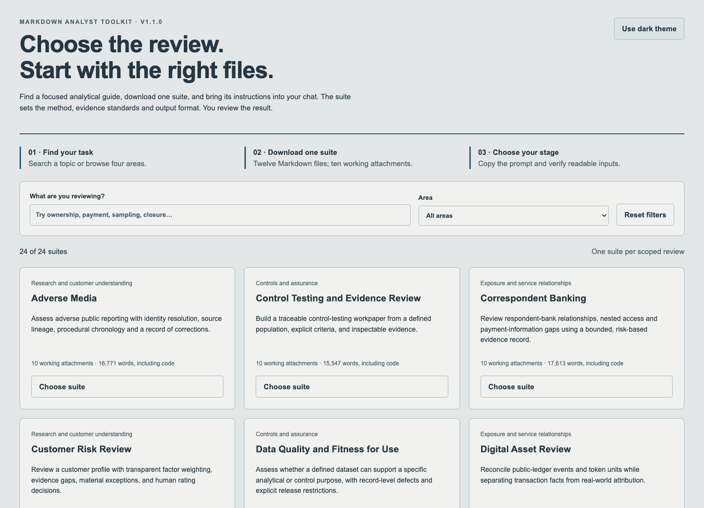
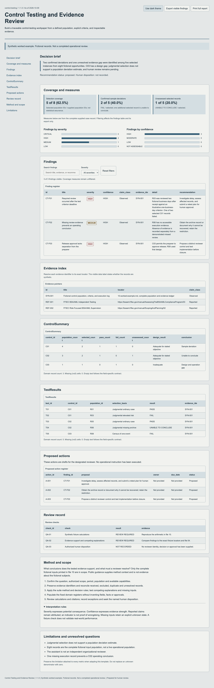
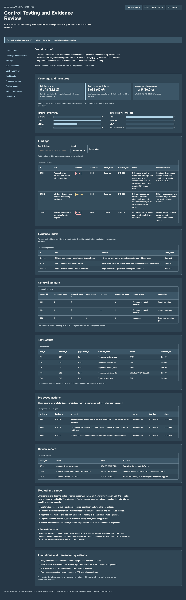

# Markdown Analyst Toolkit

Detailed, task-specific Markdown libraries for analytical work in an AI chat.
Choose a suite, attach its instructions, add approved inputs, and produce a report,
workbook or dashboard using a fixed method and template.

## In plain English

- **What it does:** gives an assistant a complete written guide for one analytical
  job, including the questions to ask, how to evaluate evidence, and what to produce.
- **How you use it:** download one topic folder and attach files 01–10 to a chat.
  The other two files explain the suite and document its build.
- **What you get:** a structured draft, traceable findings, fixed spreadsheet columns,
  a consistent report, and a dashboard with light and dark themes where file creation
  is available.
- **What you still do:** provide approved inputs, check the evidence and calculations,
  and make the consequential decision. The library does not operate a system for you.
- **What you install:** nothing. The code inside the templates is optional in-session
  rendering guidance; normal use requires no terminal, connector, scheduled job or
  repository integration.

[Start here](docs/START-HERE.md) · [Download suites](https://github.com/maxmoran23/markdown-analyst-toolkit/releases/tag/v1.1.0)
· [What was verified](docs/VERIFICATION.md) · [How the library was built](docs/BUILD-PROCESS.md)

**New to the library?** Follow the [fictional first-session walkthrough](docs/FIRST-SESSION.md),
or [choose by the question you need to answer](docs/CHOOSE-A-SUITE.md).
Download the [offline suite finder](https://github.com/maxmoran23/markdown-analyst-toolkit/releases/download/v1.1.0/suite-finder.html)
and open the saved HTML file in a browser to search topics and copy the right attachment
prompt. Its search and prompts work offline; downloading a suite requires internet access.

## Choose the decision you need to support

| Suite | Plain-English question | Main analytical records |
| --- | --- | --- |
| [Transaction monitoring](suites/transaction-monitoring/) | What explains the activity behind this alert, and what needs further review? | Transaction assessment and alert review |
| [Typologies and red flags](suites/typology-red-flags/) | How would this scheme appear in data, and what else could explain it? | Observable indicators and detection coverage |
| [Investigations](suites/investigations/) | What happened, what is supported, and what remains unresolved? | Event chronology and competing hypotheses |
| [Fraud review](suites/fraud-review/) | What is the event sequence and exposure, and which response needs human review? | Payment events and exposure/recovery analysis |
| [OSINT research](suites/osint-research/) | Which public claims are supported, independent and relevant? | Source index and claim ledger |
| [Entity due diligence](suites/entity-due-diligence/) | What can be established about an entity and its risk factors? | Entity facts and diligence questions |
| [Sanctions review](suites/sanctions-review/) | Is there a supported identity or ownership concern requiring specialist disposition? | Match evidence and disposition analysis |
| [Digital-asset review](suites/digital-asset-review/) | What do the chain records show, and how strong is the attribution? | Transfer evidence and attribution assessment |
| [Control testing](suites/control-testing/) | Did the selected control executions meet explicit criteria? | Control summary and test results |
| [Data quality](suites/data-quality/) | Is the supplied data fit for this decision, and where does it fail? | Data-quality checks and record exceptions |
| [Monitoring tuning](suites/monitoring-tuning/) | How do candidate thresholds trade coverage, missed cases and workload? | Threshold results and segment evaluation |
| [Regulatory change](suites/regulatory-change/) | What changed, whom does it apply to, and what evidence would close the gap? | Requirement extraction and control mapping |
| [Ownership analysis](suites/ownership-analysis/) | Who owns or controls the entity, and where do the calculations stop? | Ownership edges and path analysis |
| [Third-party risk](suites/third-party-risk/) | Which service dependencies and assurance gaps require action? | Service dependencies and control reliance |
| [New-product risk](suites/new-product-risk/) | What must be resolved before the proposed activity can be considered for approval? | Product flows and launch conditions |
| [Trade surveillance](suites/trade-surveillance/) | Which market-event patterns merit review after context and alternatives are tested? | Event chronology and surveillance hypotheses |
| [Customer risk review](suites/customer-risk-review/) | Which customer factors are supported, missing or subject to an explicit override? | Risk factors and review outcomes |
| [Jurisdiction risk](suites/jurisdiction-risk/) | Which dated country factors apply to the actual exposure? | Jurisdiction factors and exposure mapping |
| [Source of wealth and funds](suites/source-wealth-funds/) | How was wealth accumulated, and what supports the origin of this funding? | Wealth bridge and funding trace |
| [Adverse media](suites/adverse-media/) | Does the reporting concern the right subject, and what does its procedural status support? | Source families and allegation assessment |
| [Correspondent banking](suites/correspondent-banking/) | Which relationships and nested activity require further evidence or review? | Relationship assessment and payment transparency |
| [Trade finance review](suites/trade-finance-review/) | Do the trade documents, goods and payments reconcile, and what explains anomalies? | Trade-document reconciliation and anomaly review |
| [Sampling assurance](suites/sampling-assurance/) | What can this sample establish about its defined population? | Sample design and selection results |
| [Issue remediation](suites/issue-remediation/) | What evidence supports implementation, effectiveness and a closure decision? | Issue conditions and validation evidence |

These are analytical functions. Administrative inbox management, calendar indexing,
routine scheduling and external delivery are outside this library's scope.

## Every suite has the same file roles

| File | Purpose | Attach? |
| --- | --- | --- |
| `README.md` | Plain-English explanation, use steps, resources and download | Browse first |
| `01-session-guide.md` | Mission, preflight, launch prompt, scope and restart rules | Yes |
| `02-inputs-evidence.md` | Required inputs, dictionaries, sources and evidence handling | Yes |
| `03-analysis-method.md` | Detailed procedure, calculations and analytical edge cases | Yes |
| `04-decision-rules.md` | Interpretation rules, competing explanations and review gates | Yes |
| `05-output-contract.md` | Exact domain columns, units, null rules and narrative requirements | Yes |
| `06-report-template.md` | Eight-section report and complete optional Word renderer | Yes |
| `07-workbook-template.md` | Fixed workbook schema, styling and complete optional Python renderer | Yes |
| `08-dashboard-template.md` | Complete self-contained HTML, theme control, filters, export and print | Yes |
| `09-quality-review.md` | Falsifiable checks, negative cases and reviewer requirements | Yes |
| `10-worked-example.md` | Complete fictional inputs, expected results and edge cases | Yes; label example mode |
| `11-build-record.md` | Content measurements, estimated resources, process and hashes | Browse as needed |

The ten instructional files carry the full method. Each folder contains twelve Markdown
files in total. Attachment count alone does not establish that the content fits a
particular model's context; per-suite estimates and a staged workflow are provided.
Do not attach the whole repository to one chat.

For work spanning multiple sessions, use the [case handoff guide](docs/CASE-HANDOFF.md).
When adopting a new release, follow the [version update checklist](docs/UPDATING-SUITES.md)
and retain the prior example check and case record. [Release notes](docs/RELEASE-NOTES.md)
describe the additions and limits of each version.

## Fixed outputs with a restrained visual system

The templates fix report sections, workbook sheet order, column names, evidence keys,
missing-value handling, typography, spacing and colors. The dashboard uses muted gray
and stone surfaces in light mode and softened navy in dark mode. Four restrained
accent families distinguish suites; severity always has a text label.

The following are actual browser captures of the fictional control-testing specimen:

| Light: muted gray and stone | Dark: softened navy |
| --- | --- |
|  |  |

Report, workbook and dashboard specimens draw from the same fictional case data.
This makes cross-format discrepancies testable. It does not guarantee an assistant
will follow the contract: inspect its actual output, including missing records and
unresolved evidence. If the session cannot create a requested file, it must return
the complete copy-ready content and state which artifact was not created.

## Depth, resources and provenance

Each suite includes its own analytical methods, source handling, rules, worked case,
counterexamples, output schemas and complete renderers. Its build record reports
measured words and bytes, a characters-per-token context estimate, and a clearly
labeled reproduction-budget estimate. Actual authoring tokens and monetary cost
were not captured per suite and are not presented as measured facts.

The visible creation sequence is **scope mapping → specialist methods → fixed
contracts → fictional case → review and verification → packaged release**.
[Build process](docs/BUILD-PROCESS.md) separates the stages and evidence. The
[verification record](docs/VERIFICATION.md) distinguishes executable checks from
manual analytical review and untested platform behavior.

## Relationship to the other toolkits

| Repository | Best fit | Packaging |
| --- | --- | --- |
| [Analyst Toolkit](https://github.com/maxmoran23/analyst-toolkit) | Broad prompt library, specialist engines, quantitative methods and reproducible engine evidence | One prompt plus its base for paste use; separate runnable engines |
| [Simple Toolkit](https://github.com/maxmoran23/simple-toolkit) | A consolidated reference system spanning many analytical functions | Large reusable cross-domain modules |
| **Markdown Analyst Toolkit** | One substantive task in a manually managed AI chat | Twelve-file topic folders, ten instructional attachments, fixed output templates |

This companion adapts methods into topic-sized libraries. It does not replace the
other repositories, carry over their synthetic engine performance claims, or require
their runtime. Public-source references and fictional examples are included; no
institution-specific data or internal operating procedures are distributed.

## Contributing

Use the [maintainer guide](docs/MAINTENANCE.md) and [repository instructions](AGENTS.md).
Changes must preserve self-contained suites, exact contracts, generic examples and
honest verification. The small `_maintainer` directory is release tooling; it is not
included in the Markdown-only suite downloads.

Licensed under [MIT](LICENSE). Sources linked inside the suites retain their own terms;
the repository paraphrases methods and does not redistribute source publications.

<!-- METRICS:START -->
**Measured instructional library:** 24 suites, 288 suite Markdown files, **392,963 words** in files 01–10. Each suite has ten instructional attachments. [Per-suite context budgets](docs/CONTENT-BUDGET.md) separate the full package, analysis stage and rendering stages. Word counts include code; repeated renderers are intentional.
<!-- METRICS:END -->
