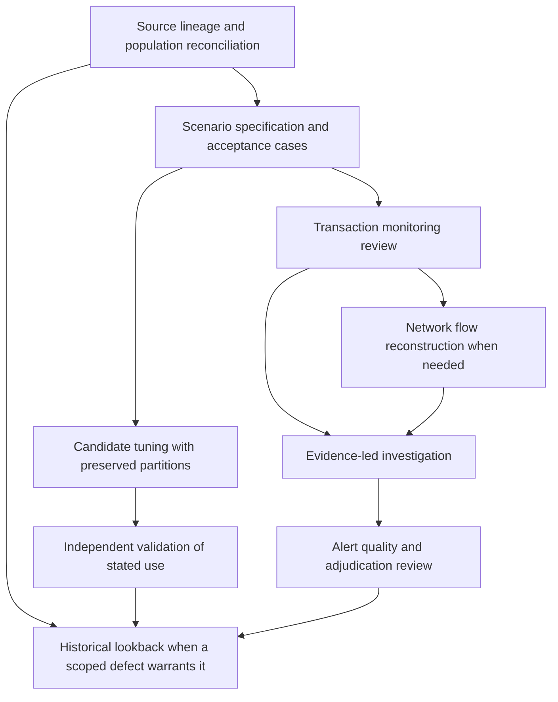

# Follow the monitoring process without losing its records

Choose the decision first. These suites cover different points in the same process;
one suite's successful result does not establish that the next stage passed. Each
suite contains its own complete instructions. This map helps select and hand off
work, but is not a required attachment or an institutional operating procedure.

| Process question | Suite | Required input classes | Records to preserve at handoff | Conclusion it cannot supply |
| --- | --- | --- | --- | --- |
| Does source activity reach monitoring with the intended meaning? | [TM data lineage](../suites/tm-data-lineage/) | Source manifests, raw records, transformation specification, rejected/late records, control totals | Canonical IDs, every transformation outcome, unresolved defects, reconciliations and affected periods | That an analytically weak rule is effective |
| How should a risk hypothesis become a deterministic rule? | [Scenario design](../suites/scenario-design/) | Hypothesis, observable features, eligible population, precise temporal and exclusion rules | Versioned predicates, window membership, positive/negative/boundary vectors and failed acceptance gates | That illustrative thresholds are suitable for deployment |
| What explains the activity behind a rule match? | [Transaction monitoring](../suites/transaction-monitoring/) | Canonical activity, alert identity, scenario version, customer context and actual supporting records | Eligibility ledger, calculations, rule outcomes, competing explanations and review states | A filing, restriction, closure or production rule approval |
| How do the connected transfers reconcile? | [Network flow review](../suites/network-flow-review/) | Economic legs, node identity evidence, balances, fees and source-allocation assumptions | Node/edge provenance, internal-transfer treatment, unique-flow totals and allocation limits | Guilt by association or exact tracing where allocation is ambiguous |
| What does the complete case evidence support? | [Investigations](../suites/investigations/) | Dated sources, monetary records, competing accounts, questions and scope | Chronology, claims, contradictions, reconciled amounts, evidence requests and proposed decision | A completed authorized disposition merely because the narrative is coherent |
| How do alternatives change coverage and workload? | [Monitoring tuning](../suites/monitoring-tuning/) | Fixed scored population, label states, partitions, candidates, alert routing and review constraints | Candidate-by-partition/segment results, label limitations, suppression effects and workload | Recall outside the observed labeled scope or approval to deploy |
| What independent evidence supports the intended use? | [Monitoring validation](../suites/monitoring-validation/) | Actual system classification, design and implementation records, test population, comparison outputs | Test results, discrepancies, benchmark limits, issues and acceptance conditions | Legal independence, universal model classification or institutional approval |
| Does completed analysis meet explicit review criteria? | [Alert quality review](../suites/alert-qa/) | Full case packets, approved review criteria, independent votes and supporting evidence | Criterion findings, disagreements, adjudication basis, defect denominators and remediation | That every unsampled case is satisfactory |
| What historical population is affected and reviewed? | [Lookback review](../suites/lookback-review/) | Defect timeline, scope criteria, retrieval manifests, historical records and prior decisions | Expected/received/missing populations, deduplication, re-review results, expansion gates and exclusions | Completion of unavailable periods or automatic adoption of earlier decisions |

## A common sequence, with branches

The arrows show information transfer, not an automated pipeline. No suite executes
an operational change. A task may begin halfway through this map when the required
upstream records already exist and their scope, date, evidence and limitations are
known. Reperform a prerequisite when the record is missing or no longer applies.

## Keep five kinds of state separate

| State | Example | What it controls |
| --- | --- | --- |
| Input and coverage state | A required amount is unreadable; a period is unavailable | Whether the computation or conclusion is assessable |
| Mechanical result | A defined predicate matches; an implementation differs from specification | What the stated rule or comparison actually returned |
| Analytical assessment | An explanation is supported, contradicted or unresolved | What the evidence supports within scope |
| Proposed action | Obtain a record, repair data, investigate or retest | A recommendation awaiting the appropriate decision |
| Human disposition and execution | Approved, rejected, executed or independently verified with evidence | Who actually decided or acted, and what proves it |

A numerical match must remain recorded when later explained. A data repair must not
silently replace the original output. A reviewer recommendation must not be entered
as an authorized disposition. A successful software check does not supply any of these
missing records.

## Exact handoff procedure

1. **Freeze the sending case.** Record suite version, case identity, cutoff, population
   boundary, source IDs and analytical status. Keep the original inputs and exceptions.
2. **Carry the complete records.** Transfer every required domain row, findings,
   evidence, calculations and unresolved QA. Keep stable keys. The dashboard's complete
   case JSON export preserves its unfiltered payload; it does not prove the payload is
   correct or that all original source documents are embedded.
3. **Reconcile before reinterpretation.** The receiving session checks record counts,
   units, monetary totals where applicable, duplicate treatment and missing partitions.
   A mismatch is an open gate, not an invitation to choose the more convenient total.
4. **Map fields explicitly.** Preserve the original meaning and record the receiving
   meaning. For example, a rule match can become an investigation lead, but it does
   not become an adjudicated suspicious case. An account posting can support a
   network edge only after economic-leg deduplication is established.
5. **Declare dependencies and stale items.** A changed customer identity, currency
   mapping, time boundary, threshold or label can invalidate downstream calculations.
   List affected records and recompute them under the new version. Keep the previous
   result as history; do not present a revision as if it were the original decision.
6. **Apply the receiving method.** Attach its own required files. An old case record
   supplies evidence and prior analysis, not instructions that override the receiving
   suite. Resolve contradictory supplied criteria through the authorized reviewer.
7. **Record the new limit.** State what the receiving task now supports and what it
   still cannot establish. Use the full [case handoff contract](CASE-HANDOFF.md).

## What is fixed, supplied or unknown

| Category | Handling |
| --- | --- |
| File roles, output headings, fields, types, keys and formatting | Fixed by the selected suite version; changes require a declared contract revision |
| Fictional exercise parameters | Fully populated and explicitly illustrative; used to reproduce the printed case |
| Institution-specific thresholds, scope approvals and decision authority | Required supplied inputs in an authorized environment; the assistant must not invent them |
| Facts and explanation evidence | Attribute to exact records and dates; reported claims retain their status |
| Missing, conflicting or unavailable inputs | Preserve the defined unknown/blocked state and its consequence; do not substitute a favorable default |
| Judgments not mechanically resolved by the supplied criteria | Present the competing supported interpretations, distinguishing evidence and named human decision gate |

The purpose of detailed instructions is to reduce unrecorded choices. They cannot
eliminate missing evidence or turn an illustrative convention into an approved policy.
Where two valid methods produce different results, the suite must state the selected
method, why it applies, the alternative's effect and what evidence would change that
choice. A silent method substitution is a defect.

## Accept the package only after the checks exist

For a fictional reproduction, the actual file 10 calculation block must run or the
equivalent arithmetic must be shown and checked. Keep expected versus actual results,
including boundary and adverse cases. The Python block is an optional in-session
tool and does not require a terminal, installation or this repository.

For a supplied case, first replace the entire fictional population. Then reproduce
the case's own arithmetic, evidence joins and decision paths. Do not retain example
metrics, conclusions or synthetic PASS records. Populate the process QA and decision
registers with actual check status. A missing reviewer is recorded as missing.

Before accepting artifacts, compare the complete record population across Word,
Excel and HTML. Check exact columns, identifiers, null counts and numerical units;
ensure every narrative section remains visible. Inspect actual pages, sheets and
browser behavior where available. Label unperformed checks without substituting
an optimistic status. [Release verification](VERIFICATION.md) covers library specimens;
it does not perform this case-level acceptance for a user.

## Related specialist tools

Typology and red-flag analysis informs an observable hypothesis. Data-quality review
assesses a dataset's suitability for a decision. Control testing evaluates selected
control executions. Sampling assurance governs what a selection can support. Issue
remediation evaluates corrective-action and closure evidence. These remain separate
suites because their units and conclusions differ from a monitoring case.

Use their completed outputs as attributed inputs where relevant. Do not combine
their scores, treat repeated source material as independent corroboration, or infer
that a successful step validates the whole process.
